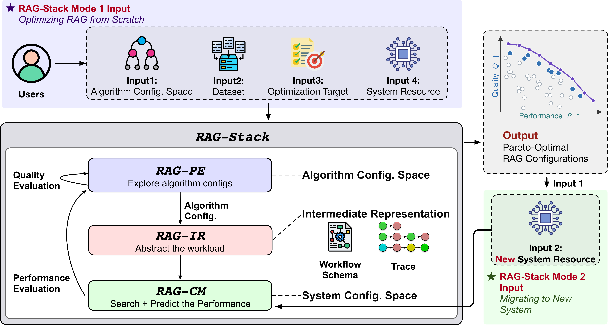
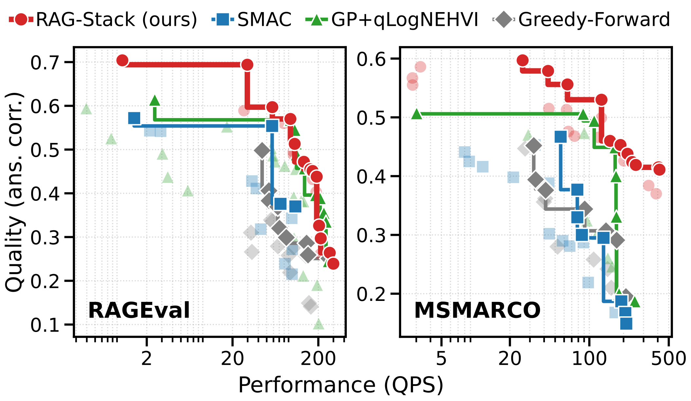

# RAG-Stack: Co-Optimizing RAG Serving Performance and Quality

<p align="center">
  <a href="docs/assets/overview.pdf">
    
  </a>
</p>

> **📚 Documentation: [docs/](https://haiqiang-zhang.github.io/rag-stack/)** — start with the
> [user guide](https://haiqiang-zhang.github.io/rag-stack/user_guide.html): launching / monitoring / resuming runs,
> RAG-Stack + RAG-CM optimization, system transfer, settings & cache
> directories. The
> [web app](https://haiqiang-zhang.github.io/rag-stack/apps.html) has its own page.

## End-to-End Benchmark

<p align="center">
  <a href="docs/assets/e2e_pareto.pdf">
    
  </a>
</p>

We evaluate RAG-Stack on RAGEval and MS MARCO using two NUMA servers (SysA: four H100s; SysB: eight A100s). On average across seeds, RAG-Stack's Pareto frontiers cover 52.5% and 153.2% more of the normalized quality–performance space than the strongest end-to-end baseline on the two datasets, respectively. At budget 50, the frontiers found by RAG-Stack cover 14.8% and 13.8% more of this space than those found by the strongest optimizer baselines on the two datasets, respectively; with 20 evaluations, the transferred frontier covers 182.2% more of this space on the new system than the frontier found by re-optimizing from scratch.

## Installation

```bash
# Clone, then initialize every bundled submodule. This includes the static
# evaluator and the separate top-level FlashRAG provider.
git clone <repo-url>
cd rag-stack
git submodule update --init --recursive

# Create environment (Python 3.12 + faiss-cpu)
conda env create -f environment.yml
conda activate rag-stack
pip install uv

# Install GenZ-LLM-Analyzer (submodule) into the active conda environment.
uv pip install -r genz_llm/requirements.txt
uv pip install -e genz_llm

# Install both local projects into that same conda environment. For API/CPU
# development and smoke tests, force the CPU Torch wheel and omit every CUDA,
# vLLM, and NIXL extra:
uv pip install --torch-backend cpu -e 'RAG-Stack-Evaluator[test]' -e .

# For measured GPU execution instead, pick the stack by your NVIDIA DRIVER
# (check: nvidia-smi). Evaluator/vLLM dependencies are owned by the
# RAG-Stack-Evaluator extra:
#   driver 525–579 -> cu12  (vLLM 0.18.1 + cu12 nixl backend)
#   driver >=580   -> cu13  (vLLM 0.22.1 + cu13 nixl backend)
# Pin the matching Torch wheel as part of the same install command.
uv pip install --torch-backend cu128 \
  -e 'RAG-Stack-Evaluator[cu12]' -e '.[cu12]'
# or:
uv pip install --torch-backend cu130 \
  -e 'RAG-Stack-Evaluator[cu13]' -e '.[cu13]'

# Optional: only for global.eval_backend: flashrag.
uv pip install -e FlashRAG
```

> **Already cloned?** Run `git submodule update --init --recursive` before
> installing so the
> [RAG-Stack-Evaluator](https://github.com/haiqiang-zhang/RAG-Stack-Evaluator)
> workspace member and the other bundled submodules are present.

RAG-Stack owns optimization, configuration, cost models, and the shared evaluator
API, registry, and global tracing hooks. `RAG-Stack-Evaluator` provides static
quality and measured execution; the separate top-level `FlashRAG/` submodule
provides an independent backend through that same API. Installing FlashRAG
registers its backend through the `rag_stack.evaluators` entry-point group.
See [FlashRAG integration](docs/flashrag.md) for native component hooks and
configuration. `static_gt`, including ReAct, does not require FlashRAG.
See [Evaluator setup and migration](docs/evaluators.md) when upgrading an existing
checkout. The environment pins MKL 2025.3.1 for FAISS CPU 1.14.1 compatibility.

> **CUDA 12 vs 13** — pick the `cu12` or `cu13` extra by your driver (above); they
> select the vLLM + nixl backend stack (cu12 → vLLM 0.18.1, the last release whose
> 1P1D disaggregation works with the cu12 nixl backend; cu13 → vLLM 0.22.1). The torch
> *wheel* is selected explicitly by the install command so its CUDA major cannot
> diverge from the selected vLLM stack. The install command
> names both editable projects explicitly because `uv pip` ignores
> `[tool.uv.sources]`. (`nixl`
> pulls both backend wheels regardless; the cu12/cu13 backend is selected at
> runtime by your torch build.) Before every local or spawned vLLM launch, the
> evaluator validates an existing `CUDA_HOME` against that Torch build and then
> discovers a matching Conda/system toolkit. The cu13 extra additionally installs
> a complete CUDA 13 wheel toolkit, which is discovered automatically on clusters
> without `/usr/local/cuda`. No activation hook, repository shell script, or manual
> `LD_LIBRARY_PATH` is required. CUDA 12's split PyPI packages do not contain an
> `nvcc` driver, so the cu12 extra installs matching precompiled FlashInfer cubins.
> If an unsupported kernel still triggers source JIT, a matching system or Conda
> CUDA 12 toolkit is required and discovered automatically. A wrong-major explicit
> toolkit is rejected instead of being used.

## Getting Started

After installation, adapt the annotated
[reference configuration](configs/rag_stack/config_reference.yaml) to your
dataset and target hardware. Replace its inline CPU block with a supported
preset or supply an explicit `hardware_key` and accurate hardware values.
Save the prepared configuration, then run:

```bash
conda run -n rag-stack python -m rag_stack optimize \
    --config /path/to/prepared-run.yaml
```

For configuration, workflows, and all other features, read the
**[documentation](docs/README.md)**.

## Replay a configuration

A resolved pipeline uses `algo_config.json` and `system_config.json`. Pass the
QA cohort and corpus separately so the same configuration can evaluate a
different training or test set:

```bash
python -m rag_stack replay algo_config.json system_config.json \
  --qa data/qa.parquet --corpus data/corpus.parquet --mode quality
```

Use `--mode measured` for hardware performance or `--mode cm` to collect a
fresh evaluator trace and run RAG-CM. See [replay usage](docs/replay.md) and the
[evaluator input contract](https://github.com/haiqiang-zhang/RAG-Stack-Evaluator/blob/main/docs/input_contract.md) for the
accepted fields and dataset schemas.

## Acknowledgements

We thank the authors and contributors of [RAGEval](https://github.com/OpenBMB/RAGEval) for making their RAG evaluation benchmark available.
