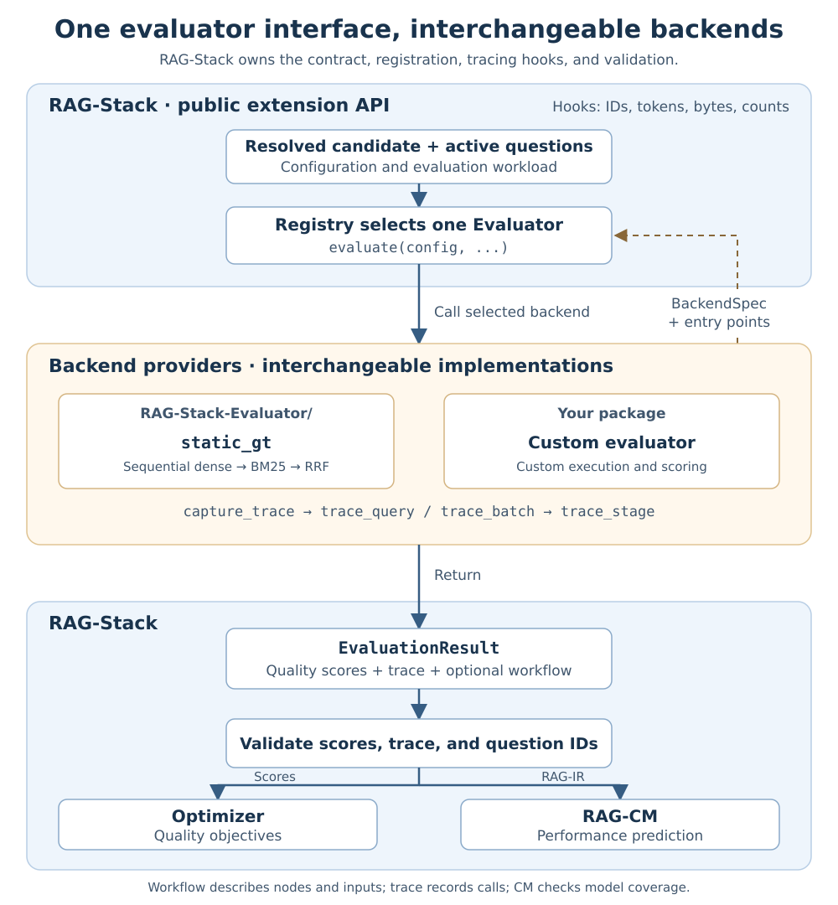

# Evaluator Extension Guide

A RAG-Stack evaluator returns **quality scores and RAG-IR**. RAG-IR consists of a
workflow schema and per-query component I/O traces. An external framework can
replace the execution/scoring backend while RAG-Stack retains optimization,
quality caching, and cost modeling for supported components.

RAG-Stack exposes three extension points in `rag_stack.evaluation`:

| Extension point | Purpose |
| --- | --- |
| `Evaluator` / `EvaluationResult` | Return named scores, a complete trace, and optional explicit workflow |
| `BackendSpec` / Python entry points | Select an external backend through `global.eval_backend` |
| `capture_trace` / `trace_query` / `trace_stage` | Capture component I/O from anywhere in an evaluator's call stack |

For the complete field reference, hook semantics, registration procedure, and
failure behavior, read the host-owned
[Evaluator API Reference](evaluator_api.md). The
[FlashRAG integration](flashrag.md) shows how a separate framework registers
a backend and records its serving components through these hooks.

## Architecture and ownership



RAG-Stack owns the `Evaluator`/`EvaluationResult` contract, backend registry,
global tracing hooks, `TraceSession`, and RAG-IR validation. Backend providers
use the same `BackendSpec` registration path and evaluation protocol:

| Provider | Backend | Implementation |
| --- | --- | --- |
| `RAG-Stack-Evaluator/` | `static_gt` | Static quality evaluation and measured execution |
| `FlashRAG/` | `flashrag` | FlashRAG pipelines and its `flashrag.integrations.rag_stack` adapter |
| Your installed Python package | Your backend name | Your execution and scoring code |

Both bundled providers are top-level submodules. An external plugin imports the
host API directly; registration and hooks require no dependency on a particular
evaluator implementation. If only a new judge is needed, the static backend
also supports its own metric adapters as an extension within that backend.

## Global hooks for any evaluator

Import the same hooks in any pipeline module. The evaluator opens a capture
scope once, binds a stable question ID, and calls its existing pipeline.
Component code does not need a recorder argument or a dependency on an evaluator
implementation. The active session is local to the Python execution context;
independent evaluations do not share a process-wide mutable trace.

```python
# my_pipeline/components.py
from rag_stack.evaluation import trace_stage

def generate_with_trace(model, prompt, prompt_ids):
    with trace_stage("generator", model_id=model.name) as call:
        call.input(token_ids=prompt_ids, text=prompt)
        answer = model.generate(prompt_ids)
        call.output(token_ids=answer.token_ids, text=answer.text)
    return answer
```

The following adapter sketch shows the complete boundary. `run_pipeline` calls
the instrumented components; `judge` is the existing evaluator's scoring
function. Both retain their own implementation.

```python
from rag_stack.evaluation import (
    EvaluationResult, capture_trace, trace_query, publish_trace,
)
from rag_stack.rag_ir import build_workflow_schema

class MyEvaluator:
    def __init__(self, context):
        self.context = context

    def evaluate(self, config, run_dir=None, metrics_override=None,
                 on_trace_ready=None):
        predictions = []
        qids = []
        with capture_trace() as session:
            for row in self.context.dataset_manager.qa_data.itertuples():
                qid = str(row.qid)
                qids.append(qid)
                with trace_query(qid):
                    answer = run_pipeline(config, row.query)
                predictions.append(answer.text)

        trace = session.finish(expected_question_ids=qids)
        workflow = build_workflow_schema(config, trace=trace)
        publish_trace(trace, workflow=workflow, on_trace_ready=on_trace_ready)
        metrics = judge(predictions, metrics_override=metrics_override)
        return EvaluationResult(metrics=metrics, trace=trace, workflow=workflow)
```

The component sketch must be extended around retrieval, reranking, and
other priced components actually used by a runner. Capture each relevant call
once, including intermediate generator calls in iterative workflows. Judges run
after trace finalization. Use actual component token IDs/counts; text requires an
explicit tokenizer callable. The hook API does not load tokenizers or estimate
counts. Optional text is reduced to exact byte sizes and is not retained.

For structured data such as retrieved document lists, record actual item
summaries. Add the hook at the existing merge call inside the component:

```python
from rag_stack.evaluation import trace_stage, summarize_lists, summarize_items

with trace_stage("retrieval_fusion", model_id="rrf_pure") as call:
    call.input(profile=summarize_lists(ids))
    fused_ids, fused_scores = rrf_pure(ids, scores, rrf_k, top_k)
    call.output(profile=summarize_items(fused_ids))
```

`ids` contains the lists actually passed to that implementation. The helpers
count occurrences, per-list sizes and distinct items, including overlap;
raw document IDs are not retained. Counts come from runtime inputs and outputs,
not configured top-k. Profile-only hooks record zero token work and leave byte
volumes absent unless explicitly measured. The optional `input_profile` and
`output_profile` fields have the same contract for every evaluator; see the
[structured profile reference](evaluator_api.md#structured-inputs-and-outputs).

This pattern requires the evaluator's active capture/query scope, just like
the generator hook. The static evaluator records its dense-retrieval `rrf_pure` calls;
do not wrap an instrumented boundary again. An evaluator records the merge it
actually executes, whether it is RRF or another operation. RAG-CM models the
recorded operation's internal work and resource use. Its current RRF integration
supports local retrieval fusion; arbitrary parallel hybrid branches require
additional scheduling support.

Use `trace_batch(question_ids)` for batched component calls. Global hooks raise
an error outside an active capture/query scope; they never silently omit calls.
Nested captures restore the previous session. Async tasks inherit their context;
thread workers must explicitly enter `capture_trace(session)` and a query scope.
The explicit `TraceSession.query()` / `.stage()` API remains available. See
[hook payloads and concurrency rules](evaluator_api.md#3-instrument-component-boundaries)
for batching, failures, and supported stages.

For structured batches, pass `profiles=[...]` with exactly one input or output
summary per question ID, in the same order. Profiles may accompany explicit
token and byte measurements. Build the workflow with
`build_workflow_schema(config, trace=trace)` after finalization so observed
fusion calls are reflected in its structure.

## Registration and configuration

```python
# my_eval/backend.py
from rag_stack.evaluation.registry import BackendSpec

BACKEND = BackendSpec(
    name="my_eval", factory=MyEvaluator,
    metrics=("answer_quality",), pipeline_modes=("sequential",),
)
```

Declare an installed entry point (or call `register_backend(BACKEND)` in an
embedded Python process):

```toml
[project.entry-points."rag_stack.evaluators"]
my_eval = "my_eval.backend:BACKEND"
```

Overlay the following on a complete RAG-Stack configuration:

```yaml
global:
  eval_backend: my_eval
  rag_ir_mode: dynamic
system:
  performance_source: cost_model
eval_backend_setting:
  metrics: [answer_quality]
  backend_options:
    runner_revision: pinned-implementation-version
```

The host registry passes `backend_options` through `EvaluatorContext.options`.
Capabilities drive host validation and registry endpoints. Plugin options are
configured in YAML. Custom backends do not automatically gain measured execution
or support for new cost-model component types.

## Host behavior and compatibility

1. Resolve the candidate and construct the selected backend lazily with the
   shared dataset manager.
2. Run the backend through the shared `Evaluator` protocol and require an
   `EvaluationResult` with finite metrics. Dynamic RAG-IR requires a canonical
   trace with exact active-question coverage for every backend.
3. Exclude reserved metadata from optimizer objectives. Use an explicit workflow
   when supplied, otherwise derive it from the resolved candidate.
4. Preserve workflow metadata in trace provenance and stored resolved configs.
   Replay the same workflow when reusing quality traces. Quality-store identity
   includes backend name and backend options, preventing cross-backend reuse.
5. Optionally overlap RAG-CM with judging when `publish_trace` sends the complete
   trace before scores are ready. Publish and return the same trace object.

The `static_gt` and `flashrag` providers adapt their existing execution engines
to the same typed result. A descriptor may advertise `supports_static_ir` for
aggregate runtime statistics; `static_gt` uses it to retain its static mode.
The FlashRAG backend uses dynamic RAG-IR. Workflow stages and presence flags must
match the resolved cost-model components. The current trace supports ordered
calls per query and concurrent independent queries, not arbitrary parallel
branches within one query. See [RAG-CM](rag_cm/README.md) for model coverage.

## FlashRAG as an independent extension

The top-level `FlashRAG/` submodule owns both the framework and its RAG-Stack
adapter. Installing that package registers the `flashrag` backend through
`rag_stack.evaluators`, exactly as an independent plugin would:

```bash
git submodule update --init FlashRAG
uv pip install -e FlashRAG
```

The adapter resolves the candidate into a native FlashRAG pipeline, activates
capture for the serving invocation, and associates component calls with the
active question IDs. Its framework integration records retrieval and generation
I/O through the host's global hooks. After serving, it finalizes and publishes
the trace, then runs the native quality evaluator outside capture. The adapter
returns `EvaluationResult` containing the native scores and completed trace. The host controller consumes the same result contract
as it does for `static_gt` or a user-installed backend.

See [FlashRAG integration](flashrag.md) for installation, the native framework
boundary, supported settings, and CPU validation. Adding another framework
follows the same steps: implement the evaluator protocol, instrument the
serving calls, and register a descriptor. New component types may also need a
cost model; backend registration alone does not add one.
