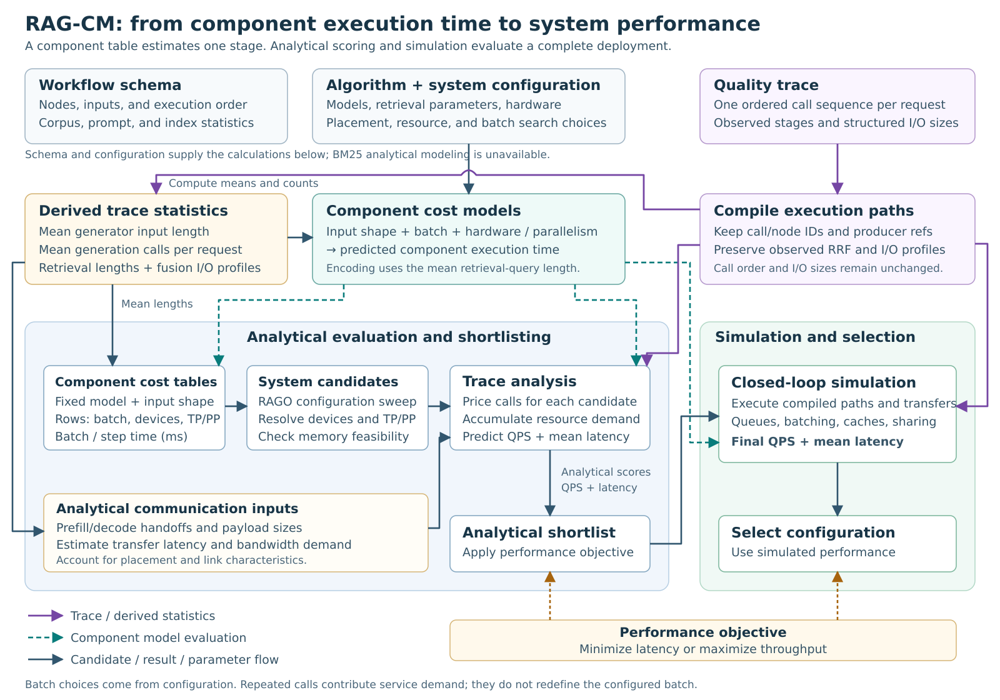

# RAG-CM — the cost model: entry points and how to use them

RAG-Stack has one production cost-model package: `rag_stack.cost_model`.
Its entry class, `rag_stack.cost_model.assembly.RAGCMAssembly`, predicts the
serving performance (qps / latency) of a resolved RAG pipeline on declared hardware
from analytical component models plus a closed-loop discrete-event simulator,
with no GPUs at pricing time.

For a real fixed-deployment execution preview, use
[`RAGCMAssembly.compile_fixed`](compiled_plan.md). It returns the in-memory compiled path
used by fixed CM analysis and simulation, with source-call mappings and
explicit calibration/unsupported-component failures.

A **component cost model** is a function that predicts a stage's service time
from its workload shape, batch size, hardware, and parallelism. A **component
cost table** samples that function for one representative workload shape over
batch and device choices. A **system candidate table** instead contains
complete deployment configurations, each with its own placement and batch
settings. The [architecture guide](architecture.md) gives a concrete
676-token prefill-table example and traces these objects through RAG-CM.



The component tables support candidate construction and feasibility checks.
Trace-aware analysis produces the shortlist scores; the simulator evaluates
the retained candidates with the original trace and component service
functions. Both final throughput and mean latency come from simulation.

## Cost model and evaluator ownership

RAG-Stack owns the cost model, calibration orchestration and fitted profiles.
The pinned [`RAG-Stack-Evaluator`](../evaluators.md)
submodule owns quality evaluation, measured execution, dataset adapters and
vLLM instrumentation. Calibration runners reuse those runtime implementations
through `rag_stack_evaluator.*`; RAG-Stack does not keep a second evaluator
implementation. Follow the [installation instructions](../evaluators.md)
to initialize recursive submodules and install both editable packages in the
same environment.

Both `static_gt` and the independently installed FlashRAG provider return the
shared `rag_stack.rag_ir` contract consumed by the CM. The FlashRAG adapter
lives in the top-level `FlashRAG/` submodule under
`flashrag.integrations.rag_stack`; native framework components use the host's
global I/O hooks to construct the trace. See [FlashRAG integration](../flashrag.md).
Standalone component calibration does not require enabling that backend.

## Uncalibrated hardware-spec mode

Strict calibration remains the default. For a newly declared hardware system
whose calibration campaign is incomplete, opt into the special exploratory
mode in the run config:

```yaml
system:
  system_hardware: sgs_a100x8_epyc7742
  rag_cm:
    calibration_mode: uncalibrated_spec
```

The equivalent optimize override is:

```bash
python -m rag_stack optimize \
  --config configs/rag_stack/sgs_a100x8_dragonball_agent_s45.yaml \
  --cm-calibration-mode uncalibrated_spec
```

The CLI persists the value in the project's `rag_stack_config.yaml`; resume and
hardware replay therefore retain the same policy. Set
`--cm-calibration-mode strict` before the first launch to use strict mode.
After that launch the project configuration is frozen; create a new project
to change its calibration policy.

The component rule is exact-profile-or-spec:

- if the exact component profile exists and validates, the CM uses it;
- if it is genuinely absent, the CM uses that component's analytical
  hardware-spec path instead;
- a present but malformed, stale, ambiguous, or identity-mismatched profile
  still fails closed;
- profiles are never borrowed across hardware, model, precision, or component
  identity.

GenZ-backed components use the declared GPU roofline with unit efficiency and
no calibrated intercept. FAISS uses the declared CPU/cache/bandwidth facts.
LLMLingua2 and multi-list RRF have no complete wall-service model derivable
from a datasheet, so their special-mode paths are explicitly labelled lower
bounds; host/Python wrapper work remains uncalibrated.

`calibration_profiles/stage_batch` follows a stronger all-or-nothing
fairness rule. Special mode enables stage overhead only when the exact
`system_hardware` file contains one complete, valid six-profile generation:

```text
generator
query_expansion
generator_prefill
generator_decode
query_expansion_prefill
query_expansion_decode
```

If the file is absent, contains only the valid collocated pair, or lacks any
of the four direct P/D roles, every stage-batch curve is disabled for every
candidate in that run. A malformed file still raises. The decision is frozen
once per run and propagated unchanged to DES workers, so collocated and
disaggregated candidates cannot receive different calibration coverage.

Sweep output records the policy in `cm_calibration_mode`,
`stage_batch_profile_enabled`, `stage_batch_profile_reason`, and
`stage_batch_profile_generation_sha256`. Special-mode predictions are for
new-hardware exploration and lack complete calibration coverage. The full
calibration workflow and profile-publishing requirements are in the
[calibration handbook](calibration.md).

## The frozen input contract

The CM accepts exactly **two data inputs**, plus configs:

1. **Workflow schema** (`rag_stack.rag_ir.WorkflowSchema`) — the STRUCTURE:
   dataflow type (sequential/agentic), which performance stages exist, the
   corpus-level statistics (`corpus_stats`, see below), and — for the
   no-trace static path — the aggregate `runtime_stats`.
2. **Quality trace** (canonical envelope) — the DATA: one complete ordered call
   sequence per dataset question, produced by the quality run itself. Tokens and
   bytes only; **no runtime observations** (no padding shapes, batch sizes,
   latencies, QPS, timestamps).

The pricing path never reads RAG E2E `performance.json`, measured serving
records, or benchmark GT. It does read serialized calibration profiles derived
from standalone component measurements; those profiles are CM implementation
artifacts, not protocol inputs.

### Quality trace envelope

```json
{
  "queries": [
    {
      "question_id": "<unique, non-empty — one per dataset question>",
      "invocation_id": "<optional: which runtime invocation won this row>",
      "calls": [
        {"stage": "semantic_retrieval_encode", "input_tokens": 7,
         "output_tokens": 0, "step_idx": 0, "model_id": "mpnet",
         "input_bytes": 28, "output_bytes": 0},
        {"stage": "generator", "input_tokens": 2048, "output_tokens": 22,
         "step_idx": 1, "model_id": "Qwen/Qwen2.5-7B-Instruct"}
      ]
    }
  ],
  "provenance": {"lossy": false}
}
```

Envelope rules enforced by `rag_stack.rag_ir.validate_quality_trace_envelope`
(at the producer and again at CM intake) are:

* every included `question_id` is unique and non-empty;
* **Call whitelist** (hard-rejected if anything else appears):
  required `stage`, `input_tokens`, `output_tokens`, `step_idx`;
  optional `model_id`, `input_bytes`, `output_bytes`.
* **Bytes are optional, never zero-filled** — an absent byte count means
  "unknown" (token-based fallback); `0` means "zero bytes".
* Every query must be **complete**: its final call is the terminal
  `generator` call.
* `provenance` is free-form and cannot affect pricing; selected fields may be
  copied into diagnostics (the trace converter records lossy status there).

Dataset cardinality, row order, and `provenance.lossy=false` are additional
producer/replay admissibility checks because the generic envelope validator
does not know the source dataset. A structurally valid canonical envelope can
therefore be lossy. When replaying stored results, require a frozen manifest
that establishes the stronger dataset contract.

Anything that is not the canonical envelope is rejected with an error pointing
at the one-off converter (see "Trace format validation and conversion" below).

### Corpus statistics (`WorkflowSchema.corpus_stats`)

Corpus-level distributions the per-question trace cannot carry — they ride
on the schema (never as config side channels):

| Field | Meaning |
|---|---|
| `avg_chunk_tokens` | mean token count of corpus chunks |
| `avg_query_tokens` | mean token count of evaluation questions |
| `avg_output_tokens` | mean reference-answer token count used as an initial generation-length estimate |
| `prompt_template_tokens` | token count of the fixed prompt text, excluding substituted question/context |
| `bytes_per_token` | byte/token ratio for communication volumes |
| `chunk_token_quantiles` | chunk-length distribution grid — powers the analytic reranker-padding price (E[max over a pad group]) |
| `avg_compressor_elems_per_chunk`, `avg_compressor_elem_tokens` | compressor element shape |
| `avg_*_input_tokens` overrides | optional per-stage refinements |
| `vectordb_index_sizes` | vectordb name → N vectors (FAISS pricing; missing N is an error, never a silent default) |

`build_workflow_schema(pipeline_config)` lifts them automatically from the
producer-stamped config; `CorpusStats.token_stats_dict()` reproduces the
original stats dict byte-for-byte.

<a id="the-three-public-entry-points"></a>

## The three performance-evaluation entry points

```python
from rag_stack.types import SystemConfig
from rag_stack.cost_model.assembly import RAGCMAssembly

hardware = SystemConfig.from_dict(system_dict)
assembly = RAGCMAssembly(hardware)

# 1. sweep + trace (the optimizer's normal dynamic path):
#    CM sweeps the system space internally and prices each deployment
#    against the recorded quality workload.
assembly.evaluate_dynamic(pipeline_config, workflow_schema=schema, trace=envelope)

# 2. sweep, no trace (CM-init / static replays / rag_ir_mode=static):
#    aggregate information rides on schema.runtime_stats.
assembly.evaluate_static(pipeline_config, workflow_schema=schema)

# 3. fixed deployment (THE way to test the CM):
#    price exactly one deployment — no sweep.
assembly.evaluate_fixed(pipeline_config, system_config, trace=envelope)
```

All three return an `AssemblyResult`: `performance_score` (the selected
scalar, e.g. max-throughput qps), `rago_result_df` (per-deployment rows:
`qps`, `latency_s`, per-stage prices), `best_hw_params`.

Trace-driven evaluation also [compiles the execution paths automatically](execution_path.md).
For local dense-retrieval fusion, the evaluator records actual RRF calls and
their structured I/O profiles. RAG-CM preserves those stages and derives work
from their observed sizes; it never inserts RRF based on query expansion.
The static evaluator captures its dense-retrieval fusion calls automatically. Custom evaluators
use the global hooks at their component boundaries. Users do not construct
RRF algorithm models as an additional input. The algorithm-model contract
is an extension interface for component-model developers.

## Fixed mode — minimal working example

Every evaluated trial archives the exact triple the fixed mode needs:

```python
import json
from rag_stack.types import SystemConfig
from rag_stack.system_layout import cm_fixed_pipeline_config
from rag_stack.cost_model.assembly import RAGCMAssembly

d = "tmp_outputs/rag_stack_projects/<project>/evaluations/eval_0009"
pcfg  = json.load(open(f"{d}/pipeline_config.json"))          # resolved pipeline (carries _token_stats)
scfg  = json.load(open(f"{d}/system_config_resolved.json"))   # resolved deployment layout
trace = json.load(open(f"{d}/execution_dag.json"))            # canonical quality-trace envelope

hw = SystemConfig.from_dict(cm_fixed_pipeline_config(pcfg, scfg)["system"])
result = RAGCMAssembly(hw).evaluate_fixed(pcfg, scfg, trace=trace)
print(result.performance_score, result.rago_result_df.iloc[0]["latency_s"])
```

`system_config` is the resolved layout JSON (`resource_groups`, per-engine
devices/tp/pp, `batch_size_request`/`batch_size_decode`) — exactly the file
the runtime archives. The CM derives collocation groups, chip counts and
retrieval servers from it; nothing else is consulted.

## Sweep mode — how the optimizer feeds the CM

With `system.performance_source: cost_model` in the run YAML, each trial's
quality evaluation records the per-question execution trace at runtime; the
controller hands `(pipeline_config, schema, trace)` to `evaluate_dynamic`,
and the CM sweeps `system.cm_search_space` internally to select the best
deployment. No measured data is involved anywhere in that loop.

Independent shortlisted deployment signatures are simulated in a persistent
spawn pool whenever more than one candidate exists. The automatic worker count
uses the process CPU affinity minus two CPUs reserved for the parent and host
services (and never exceeds the shortlist size). Use `CM_DES_WORKERS=1` (or
`CM_DES_SERIAL=1`) for a strict serial replay. Setting `CM_DES_WORKERS=N` can
request a smaller diagnostic pool but remains capped at affinity minus two.
CM fixes OMP, OpenBLAS, MKL, NumExpr, Accelerate and BLIS to one native thread
before spawning the pool, so an optimizer-level CPU count is expressed as
independent DES processes rather than nested sleeping thread teams.
The same affinity-minus-two ceiling is shared by per-stage generation and
RAGO placement-strategy pricing; each phase additionally caps its workers at
the number of independent tasks available in that phase.

Each adaptive DES saturation probe uses two concurrency turnovers for warmup
and two for its deterministic measurement window; the offered concurrency then
grows until real server queues show sustained backlog in at least three of the
five simulated-time samples at 10/30/50/70/90% of the window. Only
`_Engine.waiting > 0` or `_StageWorker.queue > batch_cap` counts;
logical-admission/frontend occupancy does not. QPS is reported only from that
proved window and never participates in saturation detection or fitting. This
bounds token-step work without making client concurrency a workload axis or
changing any queue, batch, kernel, or transfer physics. The public
`simulate(..., warmup_turnovers=..., window_turnovers=...)` surface remains
available for longer convergence audits. Production decode additionally uses
a lazy logical-token epoch: resident input/generated-token aggregates and
completion buckets replace the former full resident scan on every token while
preserving scheduler-step prices and FCFS completion order exactly. Set
`CM_DES_DISABLE_LAZY_DECODE=1` only for an eager-vs-lazy numerical audit.

The dynamic pipeline has explicit analytical, screening, and simulation
boundaries. `DynamicEngine.analyze` uses the original trace to estimate
request execution times and per-resource demand, then derives throughput and
latency estimates from capacity and concurrency models. The shortlist reads
these `dynamic_analytical_*` scores and follows
`system.performance_objectives.selection`: throughput is maximized, latency
is minimized, and compound policies retain candidates from their relevant
rankings. RAGO's coarse aggregate-based performance values are overwritten
before this ranking.

The closed-loop simulator receives the explicit shortlist and original trace.
It supplies final `qps` and `latency_s`; TTFT/TPOT fields remain analytical
estimates. All original rows remain in `rago_sweep.csv`: pruned rows are
marked `simulator_status=screened_out`, with zero QPS and infinite latency.
Final selection considers only `simulator_status=ok` rows and uses the same
configured objective.

For each ranking, ordinary large sweeps retain five request/decode batch
parents per concrete topology within each workflow and generator/query-expansion
P/D stratum, plus a global top-ten parent rescue. Every topology is preserved.
Sweeps with at least 4096 rows retain one parent per topology plus the rescue.
Every dynamic-timeout sibling of a retained parent is kept together; compound
policies take the union of their shortlists. These are search-compute budgets,
not calibration coefficients, and do not alter retained candidates' physical
predictions. The applied budget is recorded as `hybrid_parents_per_topology`.

Fixed mode and sweeps below 256 rows remain exhaustive. Set
`CM_DES_EXACT_ALL=1` to force exhaustive DES for a comparison. See the
[architecture guide](architecture.md) for the separate responsibilities of
trace preparation, candidate construction, analytical estimation, screening,
and simulation.

RAG-CM requires `cm_search_space.no_microbatching: true`. This means every
stage before decode shares `batch_size_request`; it does **not** tie decode to
that batch. RAGO independently sweeps the generator decode concurrency and
RAG-CM materializes each RAGO `batch_size_generator_decode` value one-to-one
as the deployed `batch_size_decode`. Every `(request batch, decode batch)`
candidate is therefore a distinct configuration. Its identity is always
validated and retained; in a large sweep it is either explicitly screened or
simulated exactly once. Divergent axes or duplicate normalized configurations
are rejected instead of being hidden by signature grouping.

The requested decode grid is CM-owned and is passed into RAGO explicitly; a
component Pareto frontier is not allowed to truncate deployable resident
depths. By default it is the powers of two through
`max_batch_size_request`. An explicit `cm_search_space.batch_size_decode` grid
adds those depths while retaining the `decode=request` baseline, and scalar
`system.batch_size_decode` pins each row to `max(request, pin)`. Concrete-device
repricing and DES determine performance after the candidate exists.

## Trace format validation and conversion

`execution_dag.json` files containing bare lists or envelopes with
`trace_scope` are rejected by the CM. Convert them to the canonical envelope
before evaluation:

```bash
# one file
python benchmarks/rag_cm_accuracy/tools/convert_legacy_traces.py \
    path/to/execution_dag.json --scope measured_only --out converted.json

# a whole optimizer project, in place (.v1.bak backups, idempotent)
python benchmarks/rag_cm_accuracy/tools/convert_legacy_traces.py \
    --project tmp_outputs/rag_stack_projects/<project> --scope auto
```

`--scope auto` (recommended for projects) reads each
file's sibling `performance.json`: `performance.trace_scope ==
"dataset_quality_first_completion"` → lossless upgrade (`question_id` = the
dataset row position as str, cardinality checked against
`quality_rows_completed`); anything else → `measured_only`.
`--scope measured_only` treats a bare list as a saturated measured admission
queue (lossy projection: complete rows only, first occurrence per input
shape, synthetic `legacy_shape_<i>` ids); `--scope first_completion` upgrades
already-per-question lists losslessly. The provenance block records exactly
how lossy the conversion was. **Resume a project only after its traces satisfy
the canonical contract** — the controller rejects unsupported
`execution_dag.json` formats with an error naming this converter.

## Calibration profiles are not inputs

The production CM and calibration CLI resolve one run-global profile root,
`calibration_profiles/` by default, with component
profiles in `llm_sim/`, `compressor_llmlingua2/`, `faiss_ivf/`,
`faiss_hnsw/`, and `retrieval_worker/`, and stage curves in
`stage_batch/<system_hardware>.json`.

Those paths are not RAG-config inputs. `system.rag_cm` accepts only
`calibration_mode`; per-config `component_calibration_store` and
`calibration_store` fields are unsupported. Remove them instead of pointing
them at `calibration_profiles`. Use
`--profile-dir` while staging a campaign or the process-wide
`RAG_STACK_CALIBRATION_PROFILE_DIR` when intentionally activating a
different complete profile root. A candidate or target-hardware YAML must never
select different calibration coverage from another candidate in the sweep.

Migrating to a new system starts with a read-only, isolated inventory:

```bash
rag_stack calibrate status --config configs/calibrate/<box>.yaml \
  --scope core \
  --data-dir /path/to/stage/calibration_data \
  --profile-dir /path/to/stage/calibration_profiles
```

That command audits the core component and generator coverage. For a full
RAG configuration, use `--scope pipeline`; it expands the actual pipeline and
checks all required component and stage-batch evidence.

The complete identity matrix, standalone-evidence rules, migration order,
source hashes, and accuracy guards are in
[RAG-CM calibration and hardware migration](calibration.md). RAG E2E GT,
measured host wall/padding, and generic correction factors are forbidden fit
sources. Fixed134 is a regression guard only. All profiles are read-only during
pricing; build corpus × embedding workload artifacts explicitly with
the complete `rag_stack calibrate workload` command documented in the
calibration guide before a reproducible production run.
